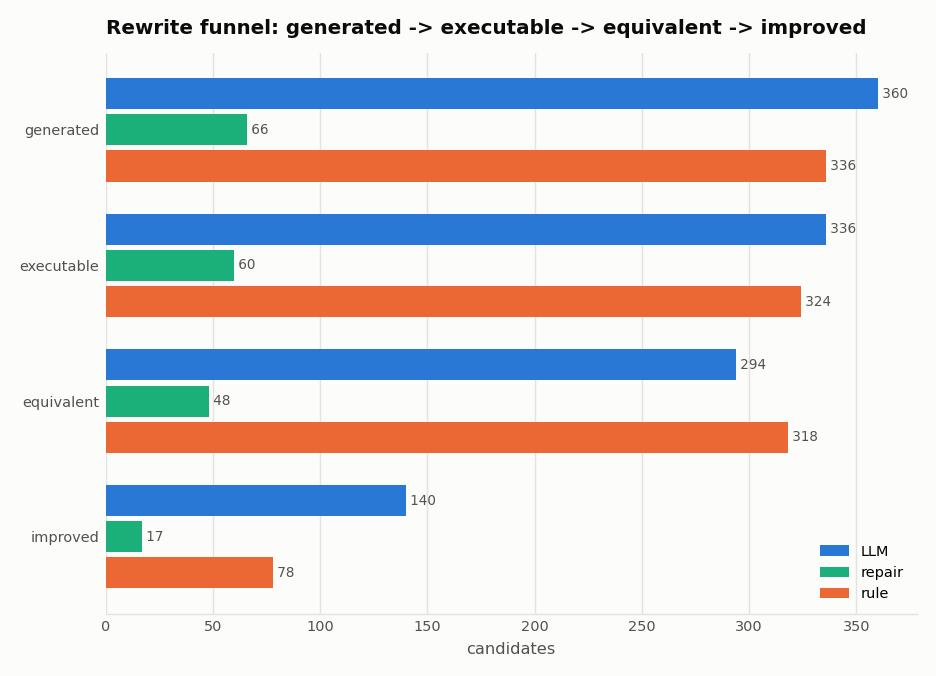
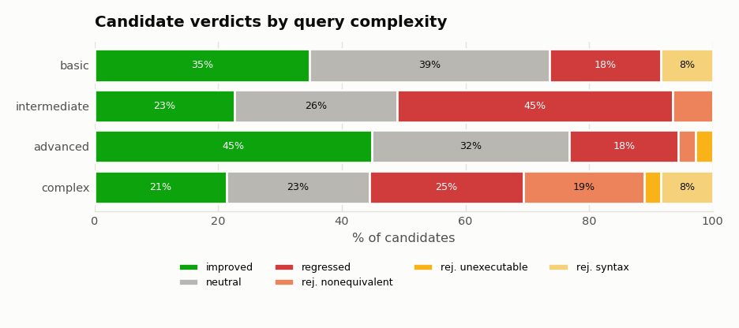
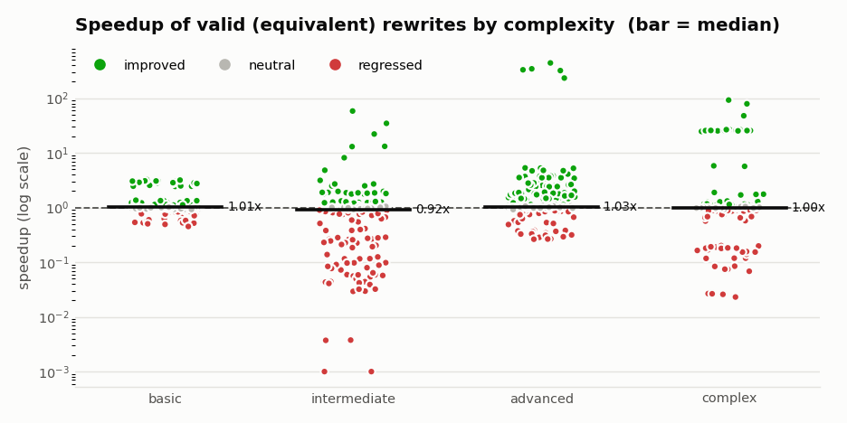
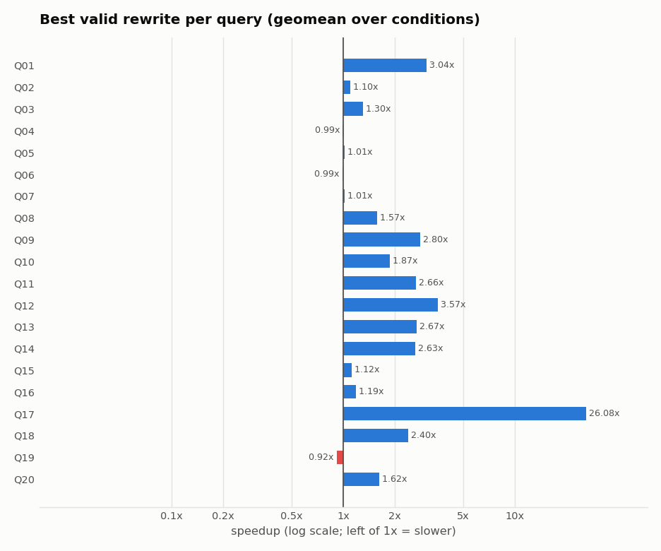
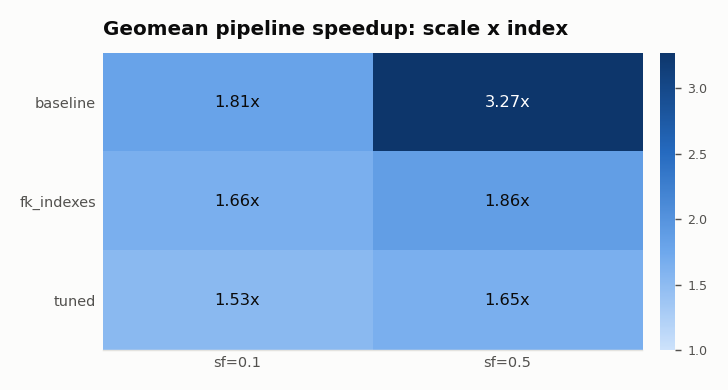
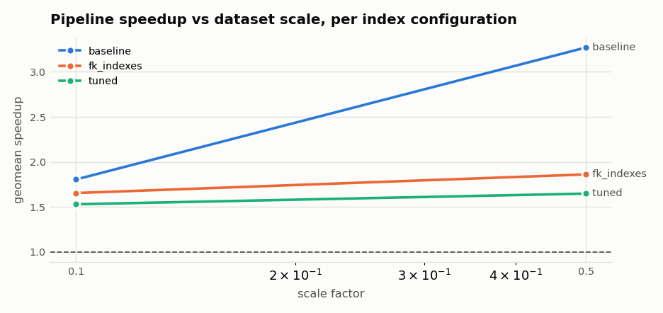
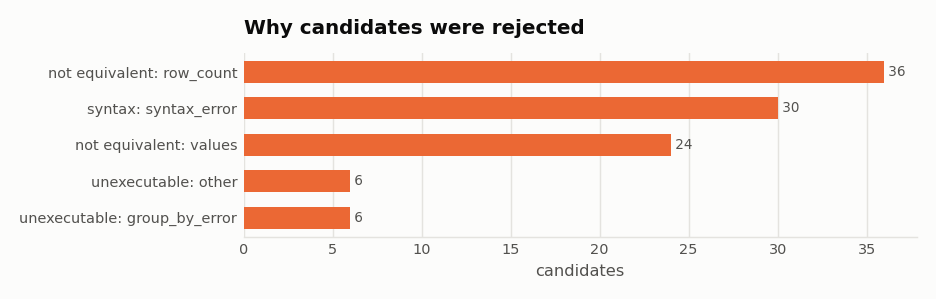

# SQL rewrite study – groq_sqlite

Backend: **sqlite** · rewriters: **groq, rule_based**

## Headline numbers

| metric | value |
|---|---|
| candidates generated | 762 |
| executable | 720 (94.5%) |
| semantically equivalent | 660 (91.7% of executable) |
| improved (of valid) | 235 (35.6%) |
| regressed / harmful (of valid) | 201 (30.5%) |
| geomean speedup of valid rewrites | 0.97x |
| query runs improved by the pipeline | 78 / 120 |
| geomean pipeline speedup | 1.89x |

## Research questions

**RQ1.** 720 of 762 generated candidates (94.5%) passed the safety, syntax and executability gates.

**RQ2.** 660 candidates were semantically equivalent: 91.7% of executable candidates and 86.6% of all candidates. Vacuous (empty-result) equivalences: 0.

**RQ3.** Of 660 valid rewrites, 35.6% improved performance by at least the threshold and 30.5% were harmful (slower). Geometric-mean speedup of valid rewrites: 0.97x (max 442.19x). Selecting the best verified rewrite per query and condition improved 78 of 120 query runs, for a geometric-mean pipeline speedup of 1.89x.

**RQ4.** By complexity level - basic: exec 91.7%, equiv 91.7%, improved 37.9% of valid; intermediate: exec 100.0%, equiv 93.5%, improved 24.1% of valid; advanced: exec 97.2%, equiv 94.4%, improved 47.5% of valid; complex: exec 88.9%, equiv 69.4%, improved 30.7% of valid. Spearman correlation of the structural complexity score with equivalence rate: -0.246, with pipeline speedup: 0.149.

**RQ5.** By database scale and index configuration - sf=0.1/baseline: 14/20 runs improved, geomean 1.81x; sf=0.1/fk_indexes: 13/20 runs improved, geomean 1.66x; sf=0.1/tuned: 12/20 runs improved, geomean 1.53x; sf=0.5/baseline: 12/20 runs improved, geomean 3.27x; sf=0.5/fk_indexes: 15/20 runs improved, geomean 1.86x; sf=0.5/tuned: 12/20 runs improved, geomean 1.65x.

## Figures

